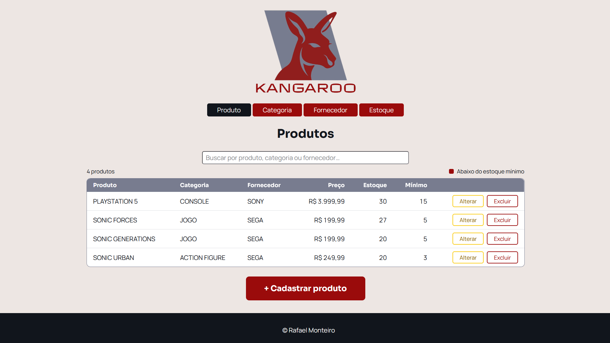

<p align="center">
  
</p>

#

Kangaroo é a evolução de um projeto anterior de gerenciamento de estoque desenvolvido em Python, originalmente executado pelo terminal. Nesta nova versão, o sistema foi reformulado para oferecer uma experiência mais visual e intuitiva por meio de uma interface web.

O sistema foi desenvolvido para pequenos negócios e permite cadastrar produtos, categorias e fornecedores, registrar entradas e saídas de estoque e acompanhar o histórico de movimentações em uma única página.

## 🖼️ Pré-visualização



## ✨ Funcionalidades

- **Produtos**: cadastro, alteração e exclusão, com categoria, fornecedor, preço e estoque mínimo. Produtos abaixo do estoque mínimo ficam destacados na tabela.
- **Categorias**: cadastro, alteração e exclusão, com a quantidade de produtos de cada uma.
- **Fornecedores**: cadastro, alteração e exclusão, com CPF/CNPJ, telefone e e-mail.
- **Estoque**: registro de movimentações de **Entrada** e **Saída** e histórico das últimas 500 movimentações.
- **Busca** na tabela de cada tela, contador de itens e avisos de erro e sucesso (alerta e toast).
- **Validações no servidor**:
  - campos obrigatórios e limites de tamanho;
  - CPF e CNPJ conferidos pelos dígitos verificadores (configurável);
  - telefone com DDD e e-mail em formato válido;
  - nomes de produto, categoria e fornecedor únicos;
  - saída de estoque bloqueada quando a quantidade é maior que o saldo disponível;
  - exclusão bloqueada quando o item está em uso (por exemplo, categoria com produtos).

## 🛠️ Tecnologias utilizadas

- **Python 3.12** com **Flask** (servidor e API JSON)
- **PostgreSQL**, acessado com **psycopg 3**
- **python-dotenv** (leitura das credenciais do banco)
- **HTML5, CSS3 e JavaScript (ES Modules)** no front-end

## 📁 Estrutura de pastas

```
kangaroo/
├── app.py              # Servidor Flask e rotas da API
├── crud.py             # Funções de cadastro reaproveitadas pela API
├── database.py         # Conexão com o PostgreSQL
├── index.html          # Página única do sistema
├── requirements.txt    # Dependências do Python
├── .env                # Credenciais do banco (não vai para o GitHub)
├── docs/
│   └── screenshot.png  # Imagem usada neste README
└── src/
    ├── assets/
    │   ├── fonts/      # Manrope e Sora
    │   └── img/        # Logo e favicon
    ├── css/
    │   └── style.css
    └── js/
        └── estoque.js  # Telas, tabelas e formulários
```

## ▶️ Como executar

### Pré-requisitos

- [Python 3.12](https://www.python.org/downloads/) ou superior
- [PostgreSQL](https://www.postgresql.org/download/) instalado e em execução, com um banco criado para o Kangaroo e as tabelas descritas na seção [Banco de dados](#-banco-de-dados)

### Passo a passo

1. Clone ou baixe este repositório e entre na pasta do projeto.

2. Crie e ative um ambiente virtual:

   ```bash
   python -m venv .venv

   # Windows (PowerShell)
   .venv\Scripts\Activate.ps1

   # Linux / macOS
   source .venv/bin/activate
   ```

3. Instale as dependências:

   ```bash
   python -m pip install -r requirements.txt
   ```

4. Crie um arquivo `.env` na raiz do projeto com os dados do seu banco:

   ```env
   DB_NAME=nome_do_banco
   DB_USER=seu_usuario
   DB_PASSWORD=sua_senha
   DB_HOST=localhost
   DB_PORT=5432
   ```

5. Inicie o servidor:

   ```bash
   python app.py
   ```

6. Abra no navegador: **http://127.0.0.1:5000**

> ⚠️ O arquivo `.env` contém credenciais e **nunca** deve ser enviado ao GitHub. Ele já está listado no `.gitignore`.

## 🗄️ Banco de dados

A aplicação espera as seguintes tabelas no PostgreSQL (colunas usadas pelo código):

| Tabela       | Colunas                                                                                          |
| ------------ | ------------------------------------------------------------------------------------------------ |
| `categoria`  | `id`, `nome` (único)                                                                             |
| `fornecedor` | `id`, `nome`, `cpf_cnpj`, `telefone`, `email` (`nome` e `cpf_cnpj` únicos)                       |
| `produto`    | `id`, `nome`, `categoria_id`, `fornecedor_id`, `preco` (NUMERIC 10,2), `estoque_minimo`, `estoque_atual`, `data_de_cadastro` |
| `estoque`    | `id`, `produto_id`, `tipo` (`Entrada` ou `Saída`), `quantidade`, `data_movimentacao`, `observacao` |

`produto.categoria_id` e `produto.fornecedor_id` são chaves estrangeiras, assim como `estoque.produto_id`. Os nomes de produtos, categorias e fornecedores são gravados em **MAIÚSCULAS**, e o CPF/CNPJ e o telefone são gravados apenas com números.

## 🔌 API

Todas as rotas respondem em JSON. Em caso de erro, a resposta traz o campo `erro` com a mensagem para o usuário.

| Método                  | Rota                          | Descrição                                |
| ----------------------- | ----------------------------- | ---------------------------------------- |
| `GET`                   | `/`                           | Página do sistema                        |
| `GET` / `POST`          | `/api/produtos`               | Lista e cadastra produtos                |
| `PUT` / `DELETE`        | `/api/produtos/<id>`          | Altera e exclui um produto               |
| `GET` / `POST`          | `/api/categorias`             | Lista e cadastra categorias              |
| `PUT` / `DELETE`        | `/api/categorias/<id>`        | Altera e exclui uma categoria            |
| `GET` / `POST`          | `/api/fornecedores`           | Lista e cadastra fornecedores            |
| `PUT` / `DELETE`        | `/api/fornecedores/<id>`      | Altera e exclui um fornecedor            |
| `GET` / `POST`          | `/api/movimentacoes`          | Lista o histórico e registra Entrada/Saída |

## ⚙️ Configuração

No início do `app.py` há uma opção para a validação de documentos:

```python
VALIDAR_DIGITOS_VERIFICADORES = True
```

Com `True`, o CPF e o CNPJ têm os dígitos verificadores conferidos. Com `False`, o sistema confere só a quantidade de dígitos (11 para CPF, 14 para CNPJ), o que é útil para testes com dados fictícios.

## 👤 Autor

**Rafael Monteiro**